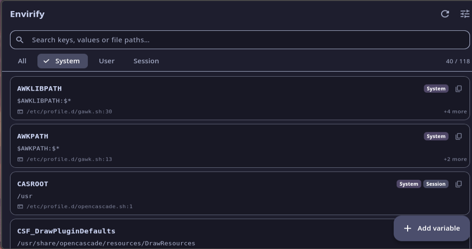
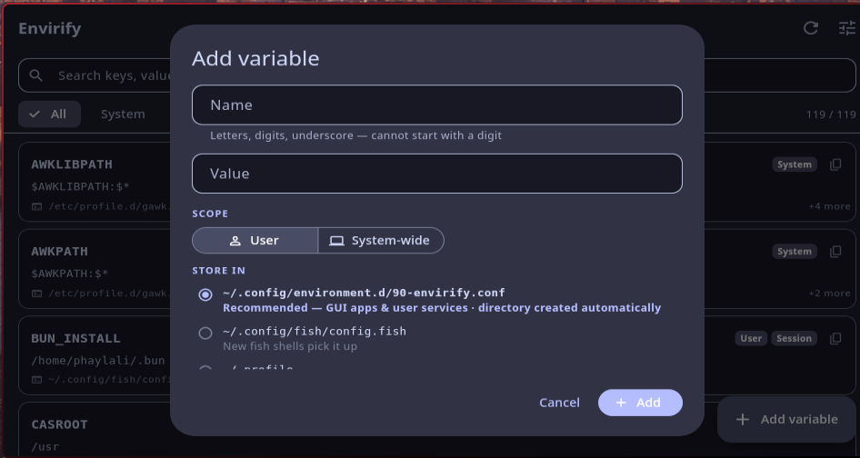
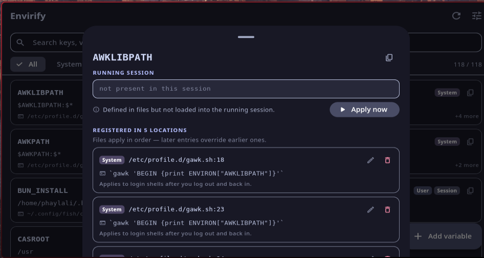

# Envirify

**Arch GUI Environment Manager — by Omniversify**

[](https://aur.archlinux.org/packages/envirify-bin)
[](https://aur.archlinux.org/packages/envirify)
[](https://github.com/phaylali/envirify/releases)
[](https://unlicense.org)

A lightweight, minimalist Material 3 desktop app for Linux that shows *every*
environment variable on your system — where it is registered, what it resolves
to, and lets you add new ones safely from a clean GUI. Think Windows'
environment editor, but for Arch and friends, with a much nicer UI.



Add dialog — scope + target file, created automatically when missing:



Detail sheet — every location, per-file edit/remove, and one-tap session apply:



## What it shows

Every value is merged by key with **every location it lives in**, in precedence
order, tagged by scope:

| Scope | Sources scanned |
|---|---|
| **System** | `/etc/environment`, `/etc/profile`, `/etc/profile.d/*.sh`, `/etc/environment.d/*.conf`, `/etc/security/pam_env.conf` |
| **User** | `~/.profile`, `~/.bash_profile`, `~/.bashrc`, `~/.zshrc`, `~/.zshenv`, `~/.config/fish/config.fish`, `~/.config/fish/fish_variables` (universal), `~/.config/environment.d/*.conf`, `~/.pam_environment`, `~/.config/envman/*` |
| **Compositor** | `~/.config/hypr/hyprland.lua` (`hl.env`), `hyprland.conf` + `conf/environments/*.conf` (`env =`) |
| **Session** | the live environment inherited by running processes |

Entries marked with a lock (OS profiles, fish universal vars, envman files) are
displayed read-only; everything else can be edited or removed in place —
with a one-time `.envirify.bak` backup of any file touched.

## What it does

- **Add variables** with two clicks: pick scope (User / System-wide) and target
  file. Files are **created automatically when needed** — including
  `/etc/profile.d/envirify.sh`, `~/.config/environment.d/90-envirify.conf`, and
  your fish/zsh/bash config.
- **Correct syntax per file**: `export K='v'` for shell, `K="v"` for pam &
  systemd, `set -gx K 'v'` for fish, `env = K,v` for hyprland.conf,
  `hl.env("K", "v")` for Hyprland's Lua config — with proper quoting
  (expansion-aware when your value contains `$PATH`-style references).
- **System writes** go through `pkexec`; if no polkit authentication agent is
  running (common on tiling WMs), Envirify starts the installed one and
  retries — and if authentication still fails, the change is staged and you
  get a copy-paste `sudo install …` command instead of losing your edit.
- **Apply to the running session**: pushes values into the systemd user
  manager and D-Bus activation environment (`systemctl --user set-environment`
  + `dbus-update-activation-environment`), so new services see them without
  re-login. New shells pick up file changes automatically either way.
- **Undo**: removing a line offers an instant undo (restores previous content).
- **Search & filter** by key, value or file path; chips for All / System / User
  / Session. The Session chip also surfaces variables that exist *only* at
  runtime (not registered in any file).

## Theming

Material 3, following your system theme. On GNOME/GTK setups Envirify reads
`gsettings` live (via `gsettings monitor`) and maps **Catppuccin** flavors —
Mocha, Macchiato, Frappé, Latte — including the accent picked in your GTK
theme (e.g. `catppuccin-mocha-lavender` → Mocha + Lavender), straight onto the
M3 color roles. GNOME accent colors are mapped too, and your system font is
used. Switch System/Light/Dark manually in Settings if you prefer.

## Install

### Arch Linux (AUR)

```sh
paru -S envirify-bin   # prebuilt binary — 7.6 MB download, 23 MiB installed
# or
yay -S envirify-bin
```

`envirify-bin` ships the compiled app: no Flutter SDK, no build time, and its
only dependency is `gtk3`, which every desktop already has.

Prefer building from source? `envirify` compiles from this repo's tagged
release — it needs the [`flutter`](https://aur.archlinux.org/packages/flutter)
package as a make dependency (~2.5 GB) and a few minutes of build time:

```sh
paru -S envirify
```

### Any other distro

```sh
./install.sh          # builds release + installs to ~/.local, adds launcher entry
```

or just run it uninstalled:

```sh
flutter run -d linux  # development
flutter build linux --release
```

## Footprint

| | |
|---|---|
| Download (AUR binary pkg) | 7.6 MB |
| Installed | 23 MiB (17 MB of that is the bundled Flutter engine) |
| RAM, idle with variables loaded | ~146 MB RSS / ~92 MB fair-share |
| RAM, peak (Add dialog open) | ~152 MB RSS / ~97 MB fair-share |
| Dependencies at runtime | `gtk3` (+ glib/pango/cairo/harfbuzz, already present) |

Build dependencies: Flutter SDK (build), `pkexec` (optional, for system-wide
writes), `gsettings` (optional, for theme detection).

## Tests

```sh
flutter test                          # parsing & file-writing logic
flutter test integration_test -d linux # full GUI flow (add/edit/remove/apply)
```

## License

[The Unlicense](LICENSE) — public domain. Do whatever you want with it.

---

by **Omniversify**
